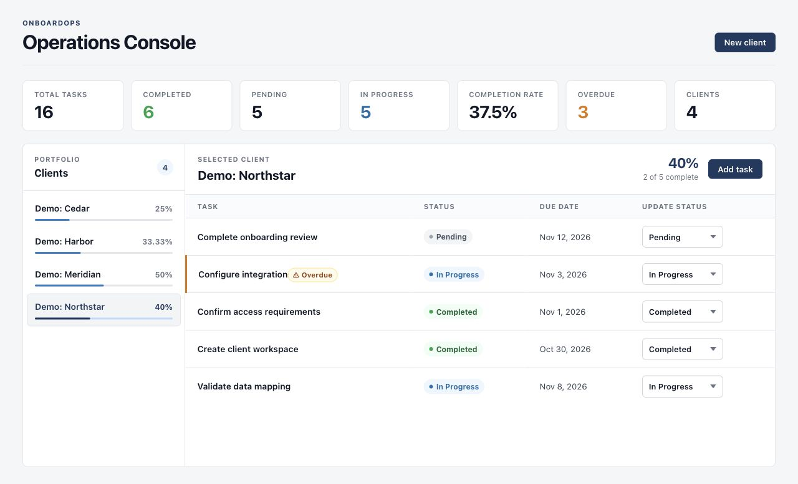
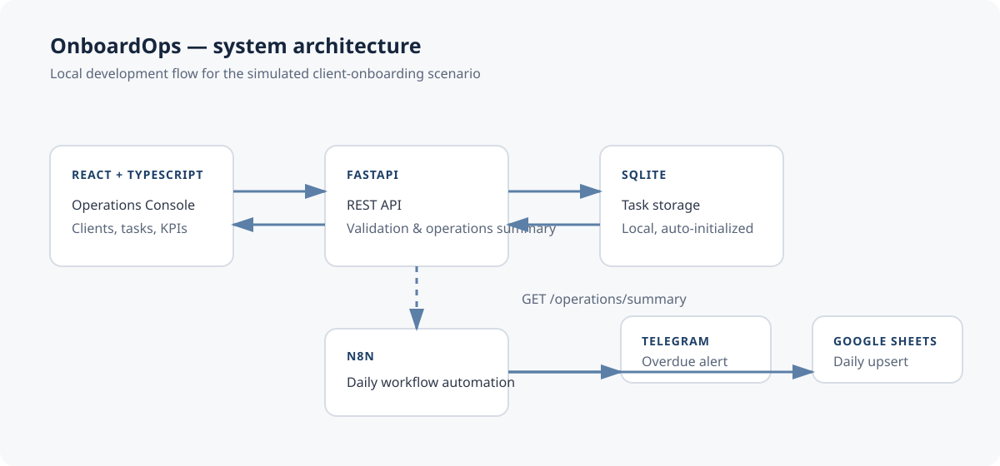
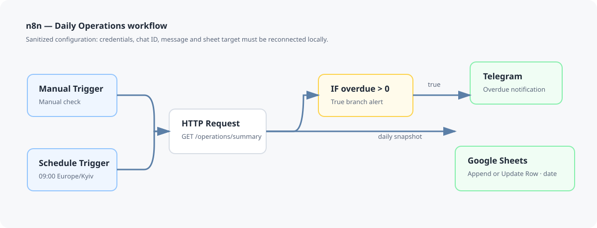

# OnboardOps — Personal Project

OnboardOps is a personal project built to apply and reinforce technical knowledge through a simulated client-onboarding workflow. It connects a React operations console, a FastAPI REST API, local SQLite storage, and an n8n workflow for daily reporting.

Tasks can be created and updated for each client. The application shows task status, deadlines, onboarding progress, and seven operational metrics. The automation reads the same API summary to conditionally send a Telegram alert and record a date-based Google Sheets snapshot.

## Operations Console



*Authentic browser capture of the running React application. Its 16 tasks and four `Demo:` clients are synthetic examples, not operational results.*

The React and TypeScript console provides client and task views, status controls, due dates, overdue indicators, per-client progress, and seven KPI cards. It also handles loading, empty, validation, duplicate-task, and API-error states.

## How the application works



React sends REST requests to FastAPI. The backend validates inputs, reads and writes task records in SQLite, and calculates client progress and operational metrics. n8n independently calls `GET /operations/summary`; FastAPI does not push reports into n8n. SQLite is local to the development environment.

The implementation uses Python, FastAPI, Pydantic, SQLite, React, TypeScript, Vite, and n8n. Tests use pytest and FastAPI `TestClient`; a Postman collection covers the API workflow.

## Automation and reporting



The sanitized, inactive [n8n export](automation/onboardops-daily-operations.json) contains manual and daily 09:00 `Europe/Kyiv` triggers. Both lead to an HTTP request for `/operations/summary`. The response feeds two independent branches:

- `overdue_tasks > 0` leads to a Telegram notification.
- Google Sheets uses **Append or Update Row**, matching on `date`, regardless of the overdue condition.

See [automation setup](automation/README.md) for local requirements and private credential rebinding. The export excludes Telegram credentials, Google OAuth credentials, chat IDs, message text, and spreadsheet identifiers.

## Operational metrics

[Task lifecycle & KPI logic](docs/operational-metrics.svg) shows a typical status progression. The API accepts any valid status change; the arrows are illustrative, not transition restrictions.

| Metric | Definition |
| --- | --- |
| Total tasks | Count of all stored tasks. |
| Completed tasks | Tasks with status `completed`. |
| Pending tasks | Tasks with status `pending`. |
| In-progress tasks | Tasks with status `in_progress`. |
| Completion rate | `completed / total × 100`, rounded to two decimals; `0%` when there are no tasks. |
| Overdue tasks | Tasks with `due_date < today` and status `pending` or `in_progress`. |
| Unique clients | Distinct `client` values among stored tasks. |

## REST API overview

[View the API map](docs/api-map.svg) for the FastAPI routes and their actual consumers. React uses the client, task, progress, overdue, and summary endpoints; n8n calls only `GET /operations/summary`.

| Area | Endpoints |
| --- | --- |
| Tasks | `POST /tasks`, `PATCH /clients/{client_name}/tasks/{title}`, `DELETE /clients/{client_name}/tasks/{title}` |
| Clients | `GET /clients`, `GET /clients/{client_name}/tasks` |
| Onboarding | `POST /clients/{client_name}/onboarding`, `GET /clients/{client_name}/progress`, `GET /clients/{client_name}/overdue` |
| Reporting | `GET /operations/summary` |

`POST /tasks` returns `201`; duplicate client/title pairs return `409`; missing task updates and deletions return `404`; unsupported status values return `422` through API validation.

## SQLite data model

[View the database schema](docs/database-schema.svg). The local `tasks` table has `id`, `client`, `title`, `status`, and optional `due_date` fields. A unique index on `(client, title)` prevents duplicate task titles within a client. There is no separate clients table: `GET /clients` derives names from stored tasks. The API validates the three task statuses; SQLite has no status `CHECK` constraint.

## Testing and validation

| Check | Result in this release |
| --- | --- |
| Python / pytest | **37 tests passed** with isolated temporary databases. |
| Postman API workflow | **20 requests, 42 assertions passed** against a separate local test database; synthetic records were cleaned up. |
| Frontend ESLint | `npm run lint` passed. |
| Frontend production build | `npm run build` passed. |
| n8n configuration | Sanitized JSON checked for the triggers, parallel branches, `date` matching, and timezone. Live Telegram and Google Sheets integrations were not executed. |

The [Postman collection](postman/OnboardOps.postman_collection.json) uses synthetic `PostmanQA_*` data and removes it at the end of a complete run.

## Run locally

SQLite initializes automatically when FastAPI starts and creates an ignored `onboardops.db` in the current directory.

### Windows (PowerShell)

```powershell
python -m venv .venv
.\.venv\Scripts\Activate.ps1
python -m pip install -r requirements.txt
fastapi dev api.py
```

In a second terminal:

```powershell
cd frontend
npm ci
npm run dev
```

### macOS (Terminal)

```bash
python3 -m venv .venv
source .venv/bin/activate
python -m pip install -r requirements.txt
fastapi dev api.py
```

In a second terminal:

```bash
cd frontend
npm ci
npm run dev
```

Open the FastAPI documentation at [http://127.0.0.1:8000/docs](http://127.0.0.1:8000/docs). Vite proxies `/api` requests to `http://127.0.0.1:8000`.

For disposable demo tasks, run `curl -X POST http://127.0.0.1:8000/clients/DemoClient/onboarding` while the API is running.

## Status and limitations

This is a local development implementation for a simulated scenario. It does not include authentication, multi-user access, deployment, cloud database infrastructure, CI/CD, or a completed Tableau dashboard. n8n credentials and runtime data remain local; the sanitized export requires private credential rebinding before use.
